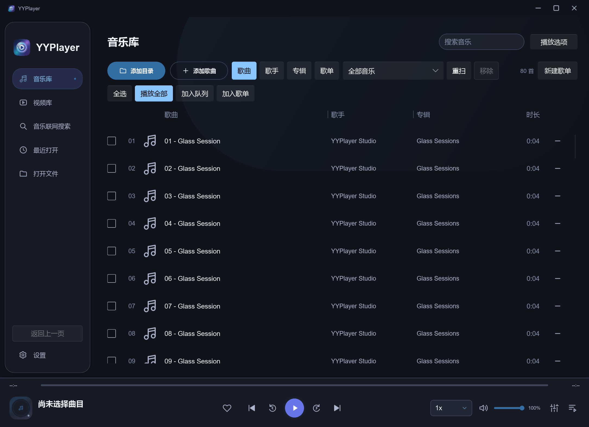
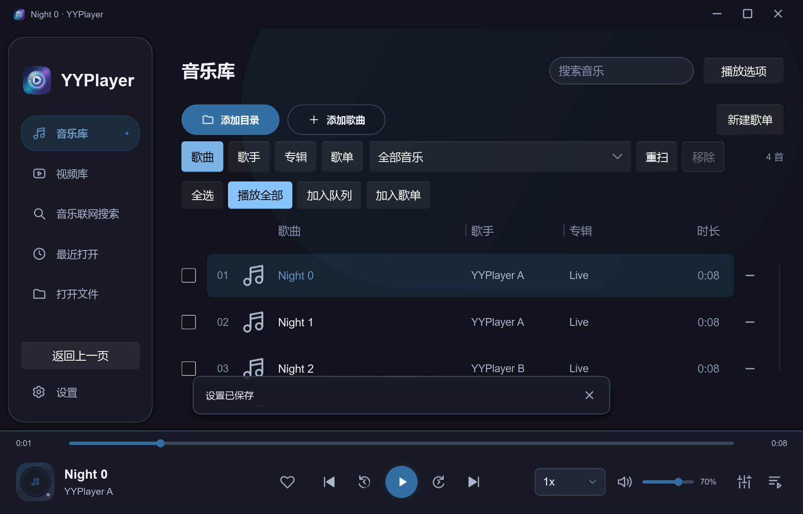
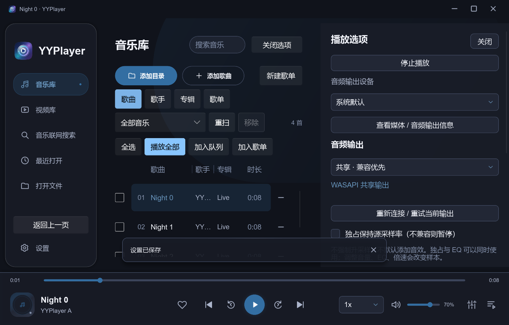
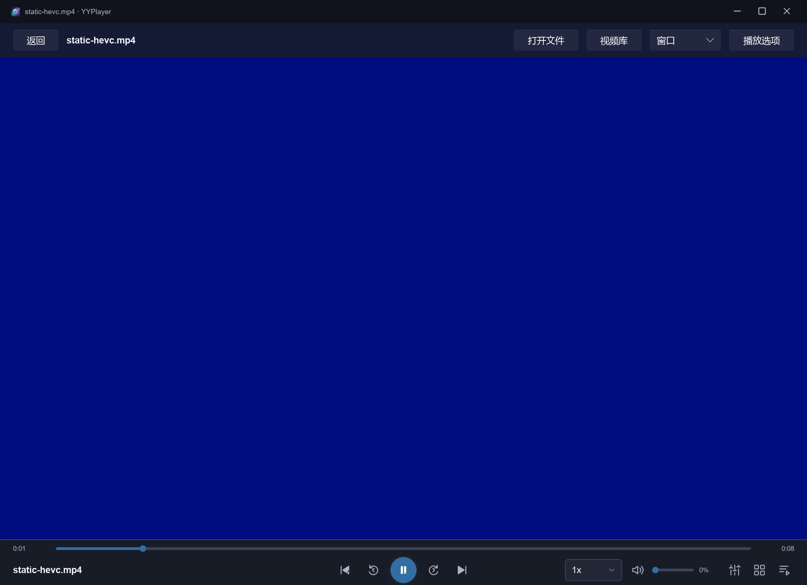
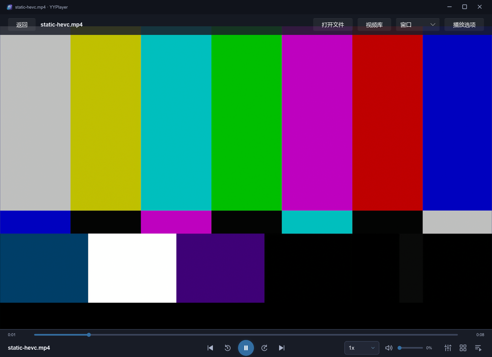

# 音乐库紧凑工具栏、AMD 去色带与 Vulkan 探索

日期：2026-10-12。沿用 dev 未提交的 0.5.0 修改，版本保持 0.5.0；没有 Git 提交 / master 合入 / 推送、安装 / 卸载或正式发行包。使用自有素材和 target 独立配置；不改用户媒体、APPDATA、显卡偏好或系统驱动。GUI / GPU 测试串行。

后续决定：用户确认继续使用 OpenGL 并停止 Vulkan 探索，随后要求更新为 0.5.1 并在 dev 本地提交。本报告保留调查时的 0.5.0 版本、EXE hash 与图像证据；0.5.1 的版本核对和提交准备见 [STATUS](../STATUS.md)。

## 音乐库

导入按钮、歌曲 / 歌手 / 专辑 / 歌单、目录或歌单筛选及管理、新建歌单集中在同一工具栏。常规 1240×900 和较宽 1840×1040 窗口为一行，相对原来三行节省 96 个逻辑像素，列头和歌曲内容随之上移；1000×640 为两行，打开播放选项后较窄内容区为三行。保留完整按钮、目录 / 歌单功能和多选操作，不挤出歌曲列。

Test-Collections 扩展为 28 阶段：常规 / 最小 / 较宽窗口的实际分类点击、最小窗口打开选项后的分类点击与透明度、分类结果、独立队列、EOF 模式、歌单保存 / 重启均验证。Test-UiCustomization 的实际列宽拖动与歌曲移除点击同步上移 96px；22 阶段通过，列宽保存约 0.56、79 首剩余，字幕 / 缩略图 / 封面 / 原生窗口动作保持。

真实持续投影时，原条件面板的局部 init 淡入可能把面板留为透明；将入场进度移到稳定 AppWindow，由 panel-open 变化触发。shell 不重复设置相同开关，导航与 collections 增加实际透明度断言。GPU take_snapshot 在 resize 同次帧仍可能返回空图；几何 / 点击和可见截图分别核对，不把黑色截图当作视觉通过。

## GPU 故障与修复

Windows 11 专业版 10.0.26300，175% 缩放，Radeon 860M / 驱动 32.0.31041.1004；系统另枚举 RTX 5060 Laptop / 32.0.16.1088。本轮实际 GL / Vulkan 渲染设备由日志确认是 Radeon 860M，它是核显；没有 AMD 独显的实机资格。

Slint / slint-build 1.17.1，FemtoVG 0.25.1，mpv `v0.41.0-1087-ge470f8986`，DLL SHA-256 `0d5b9dbecb73e179ef39dc94314ff8905fab926a80f8d60a2367d824b7254e2e`。运行时、依赖、去色带默认值和图像阈值保持。自有静态 4K HEVC / yuv420p / 30fps / 8 秒 fixture hash `3cbbf6d3a5d62541a5574528b224802acbd586338625c4dcf889193ced65ecd2`。

仅 Debug、显式 YYPLAYER_MPV_LOG 启用的 Engine 日志确认：旧路径实际是 OpenGL ES 3.2，去色带 shader 的 average 函数名触发 AMD 编译器 “redeclaration of existing name”，两个 fragment shader 编译 / 链接失败。虽然播放位置和 render 帧数仍增加，画面为蓝色。旧 0.4.1 同样复现的证据仍保留在 [前轮报告](frontend-0.5.0.md)。

Windows 生产和 GPU 例子统一经 select_gpu_backend 请求桌面 GL 3.3；实际为 3.3.0 Core Profile / GLSL 4.60 / Radeon 860M。presenter 检查实际版本 / 桌面类型，若后端降级，视频显示可恢复错误。保留 prepare_gl、同上下文 GPU FBO / 借用纹理、Engine 线程和资源释放边界，没有正常视频 CPU 图片循环。

固定 [mpv shader](https://github.com/mpv-player/mpv/blob/e470f8986e/video/out/gpu/video_shaders.c)、[Slint 请求 API](https://docs.rs/slint/1.17.1/slint/struct.BackendSelector.html#method.require_opengl_with_version)与决定见 [ADR 0011](../adr/0011-desktop-gl-and-vulkan-probe.md)；[编译日志摘录](compact-toolbar-amd-deband/shader-excerpts.txt)记录实际失败 / 成功。证据是该 GLES 编译组合的兼容性故障，不能推断所有 AMD 或独显都具有相同问题。

Test-Render 使用同一输入 / 窗口 / 图像阈值，2170×1575 截图，区域 [65,236,2039,1023]；平均 RGB 差≤1.5，单通道差>12 的坏像素比例≤1%。最终实际硬解 d3d11va-copy：

| 场景 | 平均 RGB 差 | 坏像素比例 | 结论 |
| --- | ---: | ---: | --- |
| 修复前，去色带开 vs 软件参考 | 92.408906 | 99.9995% | Fail，蓝色画面 |
| 修复后，去色带关 vs 软件参考 | 0.062545 | 0% | Pass |
| 修复后，去色带开 vs 软件参考 | 0.225618 | 0% | Pass |

deband 例子通过生产回调启用 / 关闭去色带与切换软件解码，暂停重载位置保持在 1.5 秒、误差≤0.2 秒，三次重载不重建 renderer；返回视频库释放后继续观看，renderer 只增加一次并可再次暂停。硬解无去色带、硬解去色带、软件去色带相对软件无去色带平均差分别约 0.062545 / 0.225783 / 0.235，坏像素均为 0；继续观看的软件图像差 0。去色带随机 grain 使重试均值略有差异，阈值保持；[暂停 / 重载记录](compact-toolbar-amd-deband/paused-reloads.json)。实际开关与 shader 编译都验证，不以取消去色带冒充修复。

## Vulkan

Test-GpuBackends.py 使用同一已核验 DLL，原生 vo=gpu + OpenGL / Vulkan、vo=gpu-next + Vulkan，指定 Radeon 860M。在每个后端上，去色带关 / 开各一例，六例实际播放位置≥1.5 秒、GPU 截图和正常销毁通过。硬解均 d3d11va-copy。样机 GPU 输出截图为 480×270；自有 4K 输入并不代表验证了 4K Vulkan 输出、HDR、零拷贝或性能优势。

| 原生 GPU 图像对照 | 平均 RGB 差 | 坏像素比例 |
| --- | ---: | ---: |
| gpu / 桌面 GL：去色带开 vs 关 | 0.183026 | 0% |
| gpu / Vulkan：去色带开 vs 关 | 0.207285 | 0% |
| gpu-next / Vulkan：去色带开 vs 关 | 0.102042 | 0% |
| gpu：Vulkan vs 桌面 GL，均关闭去色带 | 0.164498 | 0% |
| gpu：Vulkan vs 桌面 GL，均开启去色带 | 0.153069 | 0% |

[原生样机记录](compact-toolbar-amd-deband/native-backends.json)还包含直接创建 Vulkan Render API 的实测：返回 -19 / operation not implemented。固定 [render.h](https://github.com/mpv-player/mpv/blob/e470f8986e/include/mpv/render.h)只公开 GL / 软件后端，当前 [Slint 借用纹理](https://docs.rs/slint/1.17.1/slint/struct.BorrowedOpenGLTextureBuilder.html)要求同一 GL 上下文。因此 Vulkan 原生输出可以避开此 GLES 编译路径，但当前应用不能只改 gpu-api 或 Slint renderer 就得到等价 Vulkan 合成。进一步集成需要原生子窗口 / 覆盖控件方案，或新的 GPU 图像与同步接口；本轮没有将应用切为 Vulkan。

## 检查与限制

- cargo fmt --all -- --check；locked / offline workspace / all-targets 严格 clippy；完整 tests 通过，57 项独立测试，例子复用模块也通过，既有 HTTPS 默认 ignored。
- Test-Collections 28 阶段及重启恢复、Test-UiCustomization 22 阶段、navigation-ui 11 阶段、ui-feedback 17 阶段、audio-ui 通过；Test-VideoLibrary 十次 renderer 循环 / EOF / 位置、Test-Video 控件 / 暂停重载 / 软解 / 正常退出通过。
- Test-Render 补 shader 编译与实际桌面 GL 检查，图像全部通过；deband 例子八阶段与四组图像比较通过。python scripts/Test-GpuBackends.py 原生六场景 / 五组像素及 Render API 不支持情况已记录。
- 最终 Release 构建通过，target/release/yyplayer.exe 为 30,511,616 字节，FileVersion / ProductVersion 均 0.5.0，SHA-256 `dfdaf6998b50b167b14097405aa75997d7b2fa1079f25b5bc2ef15cecb8924c1`。独立配置的空闲启动与去色带硬解场景分别正常退出，证据见 [空闲](compact-toolbar-amd-deband/release-idle.json)与 [去色带](compact-toolbar-amd-deband/release-deband.json)。未创建 ZIP / Setup，也未重跑与本轮无实现变更的打包隔离测试。

一次与 Release 编译同时进行的 collections 运行完成全部 28 阶段后，在结束阶段触发既有五秒 Engine finish 等待超时。没有改大超时或删除清理断言；编译结束后串行、带日志重新运行，正常退出与新 controller 重启恢复通过。该次通用退出提示不能单独证明 GL 租约泄漏；高负载下退出的广泛资格仍需补证。导航 resize 同次 GPU 截图曾返回全黑，实际点击 / 几何 / 透明度与随后正常截图分别验证，未把黑图提交为 UI 视觉证据。

Linux / macOS 本轮未编译 / 真机验证，其图形 API 选择保持原样；AMD 独显、其他驱动 / GPU、物理键鼠 / 多 DPI / 多屏、DAC / 位准确 / HDR与正式发行闭包仍待验。下一步在 AMD 独显与 Linux 复验相同 fixture / 去色带 / 暂停重载。Vulkan 探索已按用户要求结束，已有原生样机不扩展为应用集成资格。
