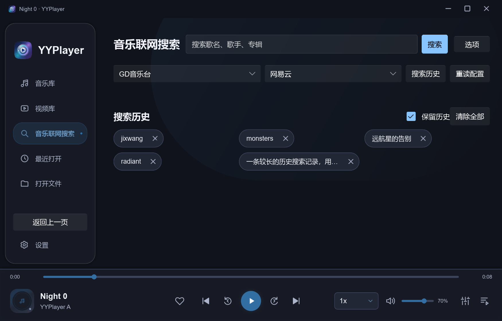
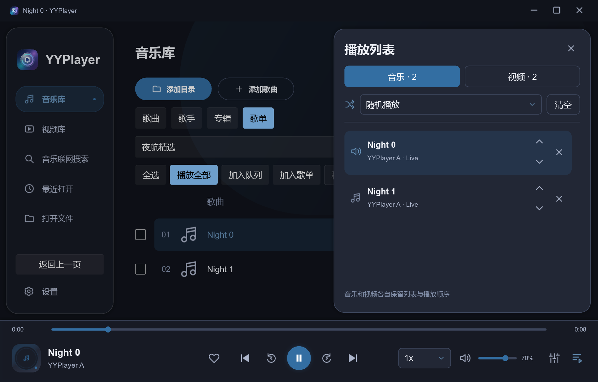

# 0.5.0：搜索胶囊、歌单分类与独立播放列表

后续补充：音乐库工具栏已合并，AMD GLES 去色带故障已通过桌面 GL 修复；最新结果见 [紧凑工具栏与 GPU 修复](compact-toolbar-amd-deband.md)。本文保留此前失败及 0.4.1 对照证据。

日期：2026-10-12。开发分支 dev，起点 `d793c4e35151b14e9b4b09206e375eab9edae77d`（0.4.1），接手时工作区干净。本轮修改未提交 / 合入 master / 推送，未生成正式 ZIP / Setup。状态：请求的前端与队列功能已完成 Windows 验证；既有 AMD 去色带图像缺陷独立保留，不能把完整 Test-Render 写成通过。

## 实现

- 搜索历史：36px 高、18px 两端圆角、文本自然宽度的按钮，按可用宽度分行，长文本省略；搜索和单项 / 全部删除保留。固定 Slint 1.17.1 使用稳定布局，不启用实验 Flexbox。
- 独立播放列表：移出播放选项，右下角按钮打开右侧覆盖抽屉。音乐 / 视频保留各自 SessionQueue 与 PlayOrder，切换抽屉标签仅浏览；支持点击播放、追加、上移 / 下移、移除、清空，抽屉不挤压视频 FBO。
- 歌单 / 分类：歌曲、歌手、专辑、歌单四种浏览；专辑键含歌手以区分同名专辑。多选 / 全选、播放所选 / 全部、批量加入队列 / 歌单；创建、重命名、删除歌单及批量移出成员，爱心绑定持久化我喜欢。
- 数据与生命周期：歌单稳定 ID / 原始 PathBuf 去重，失联 / 未索引成员保留，歌单编辑不修改队列或磁盘文件。复用后台、2MB 配置上限及原子保存；128 个歌单、合计 20000 成员，单队列 20000 项。队列仅限会话，歌单与两种媒体的播放顺序持久化。
- 顺序 / 列表循环 / 单曲循环 / 随机由 controller 唯一处理自动下一首，随机上一首回溯历史。真实 EOF 验收发现原 keep-open 结束状态可使后续 Load 留在暂停开头；load_index 增加匹配 FILE_LOADED 后的明确播放意图，输出确认 / blocked 仍由原 Engine 处理。无 Engine / presenter / prepare_gl 改动，无新依赖、运行时升级或音频默认值变化。
- 布局：为多选区域同步列头 / 行宽公式和实际拖动点击；最小窗口的空音乐库显式可伸展、减少占用边距，避免打开选项后撑大内容区。视频库行点击验收同步新增批量栏高度；导航回归同步新增右下角按钮后的播放选项位置。

使用与具体语义见 [歌单指南](../MUSIC_PLAYLISTS.md)，结构决定见 [ADR 0010](../adr/0010-playlists-and-separated-queues.md)。

## 环境与命令

Windows 11 专业版 10.0.26300，AMD Ryzen AI 7 H 350 / Radeon 860M，显卡驱动 32.0.31041.1004，当前窗口缩放 175%；Rust 1.99.0，Slint / slint-build 1.17.1，固定 mpv `v0.41.0-1087-ge470f8986`。DLL SHA-256 `0d5b9dbecb73e179ef39dc94314ff8905fab926a80f8d60a2367d824b7254e2e`。

全部媒体、配置与测试输出使用仓库 target 下的自有 fixture；不改用户 APPDATA、媒体目录或系统设置。GUI / 硬件场景串行。自有 8 秒静音 FLAC（48kHz stereo、歌手 / 专辑标签）hash `9431805a495934eb1ba11c0694189884bfd6cf5145d476d289f84c23aaa8d4bb`，12 秒 H.264 视频 hash `a1549673028fb97fd9d36bd6122025856dadb26339e55d90521f28427f3642dc`。

| 检查 | 结果 |
| --- | --- |
| cargo fmt --all -- --check | Pass |
| cargo clippy --locked --offline --workspace --all-targets --config profile.dev.debug=0 --config profile.dev.incremental=false -- -D warnings | Pass |
| cargo test --locked --offline --workspace --all-targets（同上 dev profile） | Pass；57 项独立测试，examples 的复用模块也通过；既有 HTTPS 测试默认 ignored |
| cargo build --locked --offline --release -p yyplayer-app --bin yyplayer --example collections | Pass |
| pwsh -File scripts/Test-Collections.ps1 -Release -SkipBuild | Pass，23 阶段，正常退出 / 重启恢复；[记录](frontend-0.5.0/collections-results.json) |
| navigation-ui / ui-feedback / audio-ui | Pass，实际 Slint 点击、透明度 / 几何、17 阶段通知与控件、5 张音乐布局；三尺寸、减少动态效果与简洁主题 |
| Test-UiCustomization -SkipBuild | Pass，22 阶段，实际列宽拖动保存为约 0.56、79 首剩余、缩略图、封面往返、字幕 / 字体及原生窗口动作 |
| pwsh -File scripts/Test-VideoLibrary.ps1 -SkipBuild | Pass，十次释放 / 重建、位置恢复、快速取消、移除、持久化、最小布局、普通与 EOF 后暂停 / 继续 |
| Test-Video -SkipBuild -EvidenceDirectory target/frontend-0.5.0-video | Pass，真实控制、暂停位置重载、持久化、软件解码、正常退出，实际硬解 d3d11va-copy |
| Test-Render -SkipBuild | 部分失败；普通硬解与软件图像一致，去色带异常；旧版 dev 0.4.1 对照也完全复现，详见下文 |
| Release 主程序独立配置 4 秒启动 / 退出 | Pass，exit0、ready=true、Idle、error / render_error 空，视频 renderer 初始化 0；[记录](frontend-0.5.0/release-smoke.json) |

Debug / Release 的 collections 均使用真实 AppController、Engine、GL presenter 与后台持久化；分类按钮、分组行、右下角抽屉按钮、标签与队列项用 Slint 指针事件点击，批量及歌单增删 / 命名操作调用同一生产 control。验证顺序 EOF、列表循环、单曲循环（媒体 generation 不重建）、随机下一首 / 历史上一首、视频 / 音乐往返队列保留、renderer 释放、重启恢复歌单与顺序。逻辑尺寸 1240×900 / 1000×640 / 1840×1040；截图等待实际页面透明度完成，避免将延迟帧空白误作有效截图。脚本不替代物理键鼠、文件对话框与多 DPI 真机矩阵。

首次视频库回归被历史测试目录内两份 PowerShell 5.1 错读 UTF-8 后产生的重复 fixture 阻断，已移到 target 下独立保留目录，并用 pwsh 重新生成正确自有素材。随后同步新增批量工具栏后的行点击高度，完整回归通过；没有删除用户媒体。两个打包脚本只同步版本 fixture，打包执行逻辑未改，本轮未重跑打包隔离测试或创建包。

最终主程序 `target/release/yyplayer.exe`：31,685,120 字节；FileVersion / ProductVersion 均 0.5.0；SHA-256 `b3a4176e41c97cd005bc792ee99b8c0b145048c3c80493be2d1455ef6e4229eb`。五个 workspace crate / Cargo.lock 及现行版本文档同步，无依赖增减。

## GPU 去色带对照

自有静态 4K HEVC，2170×1575 截图，比较区域 `[65,236,2039,1023]`，沿用 Test-Render 的原阈值：RGB 平均绝对误差≤1.5，超过单通道 12 的坏像素比例≤1%。

- 普通 `Auto / deband=false` 的实际 d3d11va-copy 对软件：平均误差 0.062566，坏像素 0，Pass；[指标](frontend-0.5.0/gpu-hardware-metrics.json)。
- `Auto / deband=true`：视频呈蓝色，平均误差 92.408906，坏像素比例 0.999995，Fail；独立重试同样复现。日志 / 帧数无错不能证明图像正确；[指标](frontend-0.5.0/gpu-deband-metrics.json)。
- 从已提交的 dev `d793c4e` 只读归档构建 0.4.1 Debug 对照，未修改其源码，使用同一已核验 DLL / 素材 / 参数 / 屏幕尺寸，得到完全相同的蓝色图像及两个误差指标；[对照指标](frontend-0.5.0/gpu-deband-0.4.1-baseline-metrics.json)。对照仅在 target 下构建，保留并恢复当前 0.5.0 Debug 程序。开发环境变量显式指定同一已核验 DLL，该途径绕过 loader 的自动 hash 路径，不冒充发行加载资格。

证据表明该组合的去色带缺陷在本轮之前已存在；具体根因仍待独立调查，不能推断是显卡、驱动或 mpv 单方问题。本轮不更改 GL 边界、解码选项、去色带默认值或比较阈值来掩盖失败。默认去色带仍为关闭。

## 界面与后续

已保存歌手 / 专辑与宽窗口截图及相关回归 JSON 于同目录。Linux / macOS 本轮未编译 / 真机验证；Unicode 路径跨平台、物理拖动 / 对话框 / 多屏与多 DPI、USB / 独占 / 数字捕获、HDR、安装 / 卸载及正式发行资格未新增。临时联网串流维持单首代理生命周期，歌单批量面向本地 / 已下载歌曲；文件移动不会自动追踪。

下一步：独立定位 Radeon 860M / 当前驱动 / 固定 mpv 的 deband 图像故障，先保留上述基线与实际像素比较；在 Linux 复验歌单原始路径与队列 / UI 点击；再补物理多选 / 命名、拖动 / 多 DPI 的人工验收。Git 提交、master 合入与推送按后续用户授权执行。
